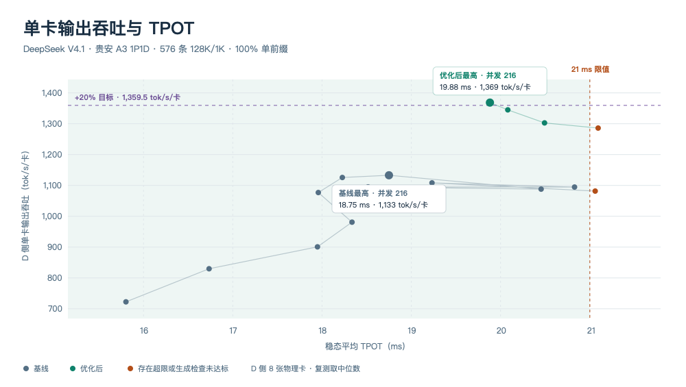

# DeepSeek V4.1 Flash on Ascend A3

在同一 Ascend A3 SuperPod 的两台服务器上部署 1P1D。P 和 D 各用 8 张物理卡、16 DIE，运行 DeepSeek-V4.1-Flash 1017 W4A8。用 AISBench 发送 576 条 128K 输入 / 1K 输出的单前缀请求，比较稳态平均 TPOT 小于 21 ms 时的 D 侧单卡输出吞吐。



## 并发 216

| 稳态指标 | 基线 | 优化后 |
| --- | ---: | ---: |
| D 侧单卡输出（tok/s/卡） | 1,132.9 | **1,368.5（+20.80%）** |
| 平均 TPOT（ms/token） | 18.75 | 19.88 |
| TPOT P90（ms/token） | 21.79 | 22.87 |
| 平均 TTFT（s） | 3.01 | 2.32 |

表中是每个配置两轮实测的中位数。每轮 576 条均成功，AISBench 稳态窗口各计入 360 条。单卡输出吞吐用窗口的输出 tok/s 除以 D 侧 8 张物理卡。图中细线按并发从低到高连接实测点，竖虚线标出 21 ms 门限。优化扫描覆盖并发 216、224、232、248。

D 侧在图捕获尺寸中加入 78，P 侧把每个 rank 的 renderer worker 从 1 调到 4。固定使用尺寸 78 的 D 和同一个 Proxy，仅调整 P worker 的同机 A/B 为 **1,204.2 → 1,372.9 tok/s/卡（+14.01%）**。 [优化细节与同机对照](docs/optimization.md) · [可机器读取的对比结果](results/comparison.json)

## 测试代码和数据

- [测试和复现步骤](docs/benchmark.md)包含 A3 环境、P/D/Proxy 启动、GSM8K 负载构造、预热和稳态计算。
- [部署脚本](deploy/)读取[基线](configs/baseline.json)、[仅调整 D 的对照](configs/graph78.json)或[优化版](configs/optimized.json)配置。[Host VMM 回移](patches/)用于两套部署。
- [压测代码](bench/)包含 AISBench 驱动、逐请求审计、InferRSI 配对适配器及绘图脚本。
- [基线曲线](results/baseline/baseline-curve.png)覆盖 [12 个并发点](results/baseline/points.csv)。[优化扫描](results/optimized/points.csv)、[同机 A/B](results/ab/pair.json)和[补充验证](results/supplemental/trials.json)均有逐轮结果。[数据字段](results/README.md)

用 Python 3.11 或更新版本可离线复算所有曲线点。绘图需要 matplotlib。

```bash
python3 bench/report.py
python3 -m pip install matplotlib
python3 bench/report.py --plot
```
