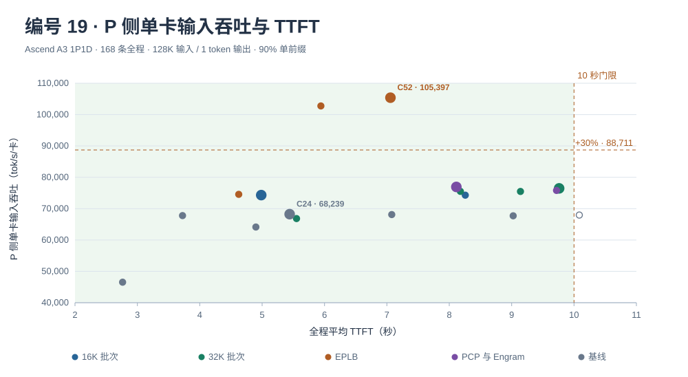

# 编号 19 · 纯 P

平均 TTFT 小于 10 秒时，P 侧单卡输入吞吐由 68,239 增至 **105,397 tok/s/卡（+54.45%）**。基线和最终优化各取两轮中位数，优化版选并发 52。两轮分别为 **105,444** 和 **105,349 tok/s/卡**，相差约 **0.09%**。 [对比结果](../results/case19/comparison.json)

## 配置对照

| 设置 | 正式基线 | 最终优化 |
| --- | --- | --- |
| P 每 rank 的 `--renderer-num-workers` | 1 | **4** |
| P 的 `--max-num-batched-tokens` | 8,192 | **32,768** |
| P 的 EPLB（`--enable-eplb`、`--eplb-config`） | 关 | **开**，STAIR 异步重排，使用 HIXL，`window_size=32`、`step_interval=40`、`num_redundant_experts=16` |
| P 的 Engram 查表重叠 | 关 | **开** |
| 正式发压并发上限 | 24 | **52** |

32K 批次保留 MegaMoE。配套修复把启动时未做 PCP 分片的模拟批次限制在每 DIE 16,384 token，运行时每 P rank 的调度预算为 32,768 token。另在 P 侧回移了 PCP AllGather 与本地 Q 投影重叠。 [生效参数](../results/case19/comparison.json) · [PCP 重叠补丁 #21628](https://github.com/vllm-project/vllm-ascend/pull/21628)

## 原表与实测

| 对照 | 并发 | P 单卡输入吞吐（tok/s/卡） | 平均 TTFT（s） | TTFT P90（s） | 168 条全程（s） |
| --- | ---: | ---: | ---: | ---: | ---: |
| 原表 | 42 | 58,583 | 10.360 | 11.974 | 46.995 |
| 原表并发下的实测基线 | 42 | 67,715 | 9.025 | 10.241 | 40.649 |
| 正式基线，两轮中位数 | 24 | 68,239 | 5.441 | 5.831 | 40.336 |
| 最终优化，两轮中位数 | 52 | 105,397 | 7.057 | 8.533 | 26.116 |

表内发压速率均为不限速。原表总输入吞吐为 468,667.43 tok/s，按 8 张 P 卡折算为 58,583.43 tok/s/卡。原表保存的是汇总数据，本次实测使用重建的单前缀数据集。正式增益使用本轮基线。基线扫描覆盖并发 8、16、24、32、42、48，另测并发 42、限速 4.5 请求/s。并发 24 是已测达标点中吞吐最高的点，并发 48 的平均 TTFT 为 10.084 秒。 [基线与优化的实测点](../results/case19/points.csv)

## 测试条件

在同一 Ascend A3 SuperPod 的两台服务器上运行 1P1D。P 与 D 各用 8 张物理卡、16 DIE。使用 0.32.0rc1 镜像、DeepSeek-V4.1-Flash 1017 W4A8、Host VMM 回移、共享 Engram、DSpark 5 和原 PD Proxy。P 采用 DP4/PCP4/TP1，D 采用 DP16/TP1/EP16 和原默认图捕获配置。基线与优化各两轮，复用同一 D 和 Proxy。 [环境和生效配置](../results/case19/comparison.json) · [Host VMM 回移](../patches/README.md)

数据集由 GSM8K 语料构造，每轮 168 条请求，每条输入 131,072 token、输出 1 token，共享前缀 117,888 token。每轮开始前清空 P 的前缀缓存，用一个独立的同前缀请求分别预热四个 P rank。基线与优化的正式轮次均完成 168 条，P 的实测前缀命中率均为 **89.94%**。

全程窗口从首条请求发出到末条完成。P 单卡输入吞吐以 22,020,096 个输入 token（含命中前缀）除以全程时间，再按 P 侧 8 张物理卡折算。验收门限为平均 TTFT 严格小于 10 秒，P90 一并记录。 [逐请求记录](../results/case19/requests.csv.gz)

## 优化与同负载对照

| 并发与设置 | P 单卡输入吞吐（tok/s/卡） | 平均 TTFT（s） |
| --- | ---: | ---: |
| 并发 24，基线（renderer 1） | 68,256 | 5.440 |
| 并发 24，仅 renderer 改为 4 | 68,189 | 5.439 |
| 并发 42，基线 | 67,715 | 9.025 |
| 并发 42，32K 批次、Engram 和 PCP 重叠 | 76,928 | 8.114 |
| 并发 42，再开启 EPLB | 102,756 | 5.942 |

并发和发压速率相同时，优化版比基线高 **51.75%**。开启 EPLB 前后在并发 42、同样不限速下的提升为 **33.58%**，两个点各测一轮。Renderer 单项变化约为 **−0.10%**。 [逐轮结果](../results/case19/trials.json)

EPLB 重排先用独立的同源请求校准两轮，再用固定的正式评估集计时。 [校准记录](../results/case19/comparison.json)

现场按基线、优化的顺序采集。InferRSI 使用已采集的逐请求记录回算验收。两轮复测支持同一部署预热后的短轮复现，跨重启、长时间运行和长输出精度仍待验证。

在仓库根目录运行 `python3 bench/report_case19.py` 可从逐请求记录核对曲线与最终增益。
